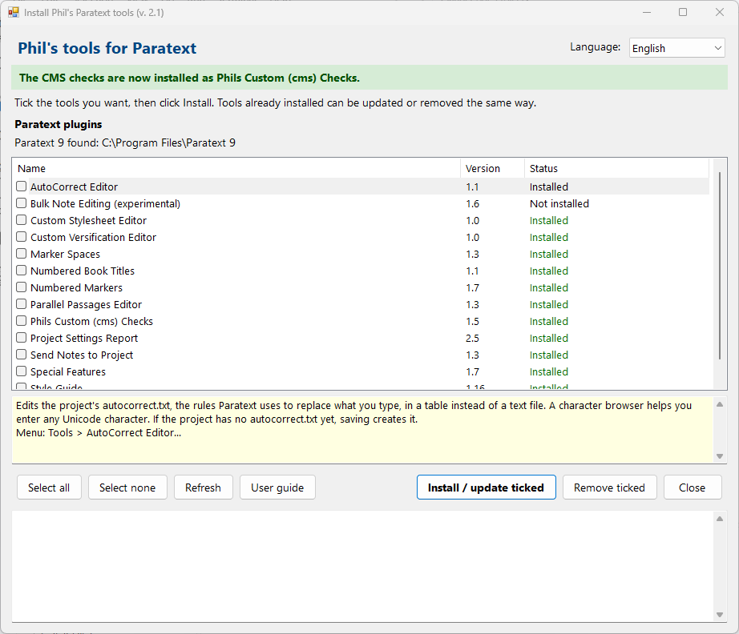

# Install Phil's Paratext tools

*This page is the English user guide, [Install_Phils_tools_UserGuide.rtf](Install_Phils_tools_UserGuide.rtf). The guide is also available in Spanish ([Install_Phils_tools_UserGuide_sp.rtf](Install_Phils_tools_UserGuide_sp.rtf)) and French ([Install_Phils_tools_UserGuide_fr.rtf](Install_Phils_tools_UserGuide_fr.rtf)).*

## Purpose

Install_Phils_tools.exe is one program that installs, updates and removes all of Phil's plugins for Paratext 9. Each plugin adds an item to the Tools menu of a project's window in Paratext.

It finds every Paratext 9 on the computer and installs into each of them. Before installing, it checks every file against the checksum it carries, so a damaged or changed file is never installed.

The descriptions of the plugins are in Paratext_Plugins.rtf, in the same folder as the installer.

## Getting the installer

1. Open the Paratext Plugins folder on Google Drive (https://short.do/HgUb7T) and click Install_Phils_tools.exe.

2. Click the Download button at the top. Google Drive warns about every program file: click "Download anyway".

3. Save the file in your Downloads folder.

4. Close Paratext.

5. Double-click Install_Phils_tools.exe. Windows may say that it protected your PC, because the program is not signed yet. Click "More info", check that the app is Install_Phils_tools.exe, then click "Run anyway".

## The window

- Language: English, Spanish or French. The list and all the texts change at once.
- The green note reminds you that the CMS checks are now installed as the plugin Phils Custom (cms) Checks.
- "Paratext 9 found:" shows the Paratext 9 programs the installer found. The plugins are installed into all of them.
- The list shows every plugin in alphabetical order, with its version and its status: "Not installed", "Installed" or "Update available". Click anywhere on a row to tick it or untick it.
- The box below the list describes the selected plugin and says where it is in the Tools menu.
- The messages at the bottom show each step of an install or removal.

## Installing or updating plugins

1. Close Paratext.

2. Tick the plugins you want ("Select all" ticks them all, "Select none" unticks them all).

3. Click "Install / update ticked".

4. When it is done, the messages end with "Start (or restart) Paratext to see the changes.", the status says "Installed", and the ticks are cleared.

5. Start Paratext. Each plugin is on the Tools menu of a project's window.

To update plugins later, run the newest Install_Phils_tools.exe: plugins with a newer version say "Update available". Tick them and click "Install / update ticked" again.

## Removing plugins

Close Paratext, tick the plugins to remove, click "Remove ticked" and answer Yes. The plugin is removed from every Paratext 9 on the computer. The projects and their settings are not touched.

## User guides

Select a plugin in the list and click "User guide". The plugin's guide opens in the window's language (in English when there is none in that language), even before the plugin is installed. "Open in another program" opens it in Word or another program for printing.

## Old CMS checks

Earlier versions of the installer copied the CMS checks into the cms folder of the Paratext projects folder. They now come with the plugin Phils Custom (cms) Checks. When old copies are found, a blue line above the list says so, with a button "Remove old CMS copies...". After you install Phils Custom (cms) Checks, the installer also offers to remove them.

- Only files the installer put there are removed.
- A file you changed by hand is kept as a .bak copy.
- Other tools in the cms folder, including Project Checker, are not touched.

## Permission from Windows

With Paratext 9 as it is usually installed, no permission is needed. Windows asks for administrator permission only for folders that only administrators can change (for example Paratext 9 Beta) and for the Parallel Passages Editor program, which goes into the Program Files folder. The prompt names Install_Phils_tools.exe: click Yes.

## If something goes wrong

- "Paratext is open...": a yellow line says that Paratext is open, and nothing is changed. Close Paratext and click "Refresh".
- "No Paratext 9 installation was found": the installer only installs into Paratext 9. Install Paratext 9 first.
- "Finished with n problem(s)": the messages above say what went wrong for each plugin. Close Paratext and try again.
- A plugin is not on the Tools menu: check that Paratext was closed during the install, that the status says "Installed", and open the Tools menu of a project's text window, not of the main window.
- Your antivirus program stops the installer: the installer is not signed yet. Download it again from the Paratext Plugins folder only.

## For testers

Install_Phils_tools.exe --cli status lists every plugin and its status without opening the window.
